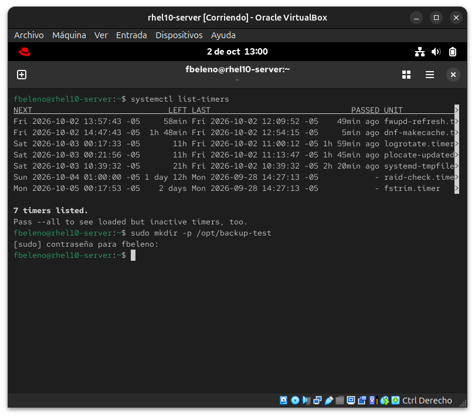

# Módulo 12 — Systemd timers (`.service`/`.timer` a mano)

- Estado: En progreso
- Fecha: 2026-10-02
- Versión: RHEL 10.2 (Coughlan)
- Objetivo diferencial frente a Fedora: los systemd timers se agregaron
  este año a los objetivos oficiales del EX200 sobre RHEL 10 (igual que
  Flatpak en el módulo 03) — no es contenido que se haya tocado en el
  curso de Fedora.

## Concepto diferencial

Un timer siempre necesita un `.service` que ejecute algo (normalmente
`Type=oneshot`) y un `.timer` que lo dispare — se escriben a mano en
`/etc/systemd/system/`, con el mismo nombre base (`backup.service` +
`backup.timer`).

**El error clásico que evalúa el examen**: hay que habilitar/iniciar el
**`.timer`**, no el `.service` — `systemctl enable --now backup.service`
lo corre una sola vez y nunca más; el `.timer` es el que programa las
ejecuciones repetidas.

**`OnCalendar` vs `OnBootSec`/`OnUnitActiveSec`**: `OnCalendar` programa
por fecha/hora tipo cron (`*-*-* 02:00:00`); `OnBootSec`/
`OnUnitActiveSec` programan relativo al boot o a la última ejecución.

**Verificación**: `systemctl list-timers` muestra próxima/última
ejecución de todos los timers activos; `journalctl -u backup.service`
confirma que el servicio corrió cuando tocaba.

## Práctica guiada

```bash
# timers ya activos por defecto en el sistema
systemctl list-timers

# preparar el terreno
sudo mkdir -p /opt/backup-test

# escribir el .service (oneshot)
sudo tee /etc/systemd/system/backup-test.service <<'EOF'
[Unit]
Description=Backup de prueba para el modulo de systemd timers

[Service]
Type=oneshot
ExecStart=/bin/bash -c 'date >> /opt/backup-test/log.txt'
EOF

# escribir el .timer
sudo tee /etc/systemd/system/backup-test.timer <<'EOF'
[Unit]
Description=Dispara backup-test.service cada 2 minutos

[Timer]
OnBootSec=1min
OnUnitActiveSec=2min

[Install]
WantedBy=timers.target
EOF

sudo systemctl daemon-reload
sudo systemctl enable --now backup-test.timer
systemctl list-timers | grep backup-test
sleep 130
cat /opt/backup-test/log.txt
journalctl -u backup-test.service
```

## Hallazgos reales

1. **RHEL 10 ya trae 7 timers activos por defecto**: `fwupd-refresh`
   (actualizaciones de firmware), `dnf-makecache` (refresco de metadata
   de repos), `logrotate.timer`, `plocate-updatedb` (base de datos de
   `locate`), `systemd-tmpfiles-clean`, `raid-check.timer`, y
   `fstrim.timer` (TRIM periódico para SSDs) — confirma que los timers
   son infraestructura central del sistema, no una curiosidad del
   examen.

## Evidencias

**01 — Timers activos por defecto**
`systemctl list-timers` mostrando los 7 timers de fábrica de RHEL 10, antes de crear ninguno propio (hallazgo #1).


## Pendientes

Falta escribir el par `.service`/`.timer` propio y verificar su
ejecución real.
