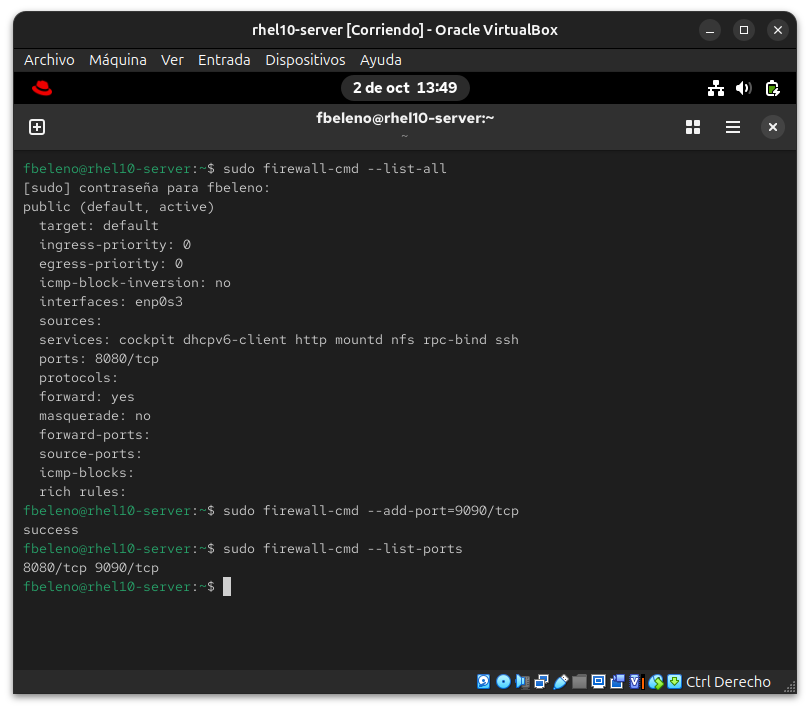
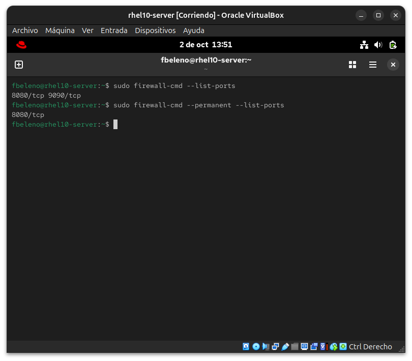
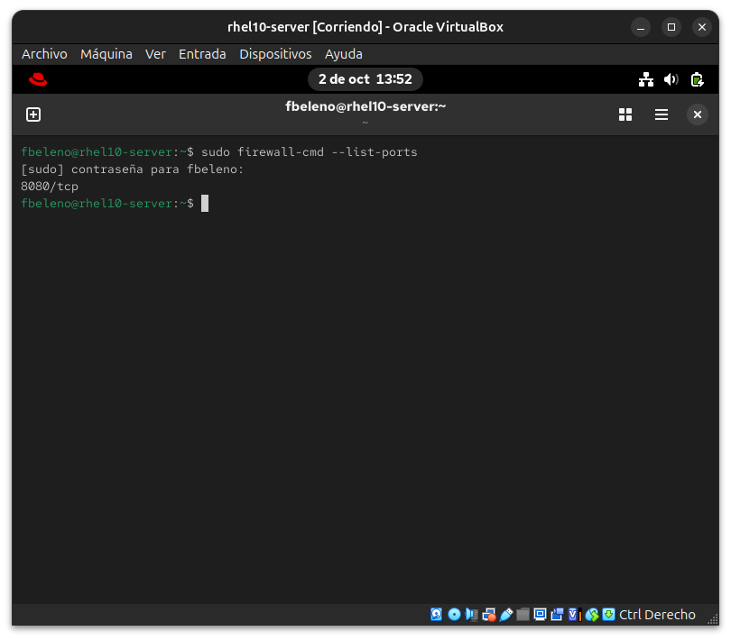
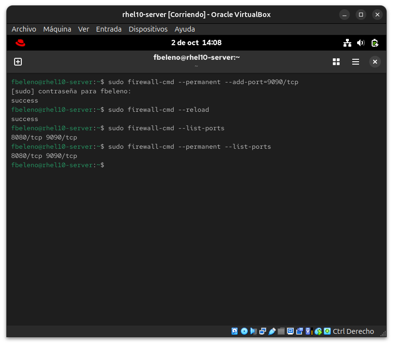

# Módulo 13 — Regla de firewall sin `--permanent` 🔧 Break & Fix

- Estado: Completado
- Fecha: 2026-10-02
- Versión: RHEL 10.2 (Coughlan)
- Objetivo diferencial frente a Fedora: el concepto runtime-vs-permanent
  de `firewalld` es el mismo en cualquier distro. Lo específico de este
  módulo es el flujo de diagnóstico esperado en el RHCSA: comparar
  `firewall-cmd --list-all` (runtime activo) contra `firewall-cmd
  --permanent --list-all` (lo que sobrevive un reboot) para detectar la
  discrepancia **sin necesitar reiniciar**.

## Concepto diferencial

Cierra la Fase III del curso (Red, servicios y scheduling). El error más
común en producción con `firewalld`: un cambio que "funciona" en el
momento pero solo tocó el runtime, y desaparece en el próximo reboot o
`firewall-cmd --reload`. Ya se advirtió en el módulo 10 — acá se vive en
carne propia.

## Cambio deliberado

Agregar una regla **sin `--permanent`**: un puerto nuevo que funciona de
inmediato, pero que no quedó guardado para sobrevivir un reinicio.

```bash
sudo firewall-cmd --list-all
sudo firewall-cmd --add-port=9090/tcp
sudo firewall-cmd --list-ports
```

## Síntoma

Inmediatamente después de `--add-port=9090/tcp` (sin `--permanent`),
`firewall-cmd --list-ports` muestra `8080/tcp 9090/tcp` — todo funciona
normal, nada indica un problema todavía. El síntoma real solo aparece
tras un reboot (o `firewall-cmd --reload`): `--list-ports` vuelve a
mostrar únicamente `8080/tcp`, el puerto 9090 desapareció sin ningún
mensaje de error ni aviso — simplemente dejó de estar ahí.

## Diagnóstico y recuperación

**Observación**: el cambio "funcionaba" al momento de hacerlo, así que
el error no se nota hasta mucho después (el próximo reboot o reload),
cuando ya es más difícil recordar qué comando específico se corrió sin
`--permanent`.

**Diagnóstico sin necesidad de reiniciar** (la habilidad real que evalúa
el examen): comparar `firewall-cmd --list-ports` (runtime activo) contra
`firewall-cmd --permanent --list-ports` (lo que realmente va a
sobrevivir). Antes de tocar el reboot, esa comparación ya mostró la
discrepancia: runtime con `8080/tcp 9090/tcp`, permanent con solo
`8080/tcp` — confirmando de antemano que `9090/tcp` se iba a perder.

**Prueba de causa raíz**: el reboot real confirmó exactamente lo
anticipado — `--list-ports` después de reiniciar mostró únicamente
`8080/tcp`. El diagnóstico sin reboot predijo el síntoma con precisión.

**Solución aplicada**: re-agregar la regla, esta vez con el flujo
correcto — `--permanent --add-port=9090/tcp` seguido de `--reload`.

**Validación**: `--list-ports` y `--permanent --list-ports` ahora
coinciden exactamente (`8080/tcp 9090/tcp` en ambos) — el puerto va a
sobrevivir el próximo reboot sin sorpresas.

## Impacto y riesgos

Una regla de firewall "fantasma" (activa ahora, ausente tras el próximo
reinicio) es particularmente peligrosa porque **no genera ningún error
visible** en el momento — el administrador verifica que el puerto
responde, da el cambio por terminado, y el problema solo aparece en el
peor momento posible: después de un reinicio de mantenimiento o un corte
de luz, cuando el servicio que dependía de ese puerto deja de ser
alcanzable sin que nadie haya tocado nada "recientemente". El tiempo de
diagnóstico se dispara porque el cambio real quedó sin rastro en ningún
log ni configuración persistente.

## Cómo evitar recurrencia

- Adoptar como hábito fijo: `--permanent --add-X` seguido siempre de
  `--reload`, nunca el comando runtime solo (`--add-X` sin
  `--permanent`) salvo que sea explícitamente una prueba temporal que se
  piensa revertir en la misma sesión.
- Después de cualquier cambio de firewall, correr la comparación
  `--list-all` vs `--permanent --list-all` como verificación de rutina,
  no solo cuando algo ya se rompió.
- En scripts de automatización (Ansible, fase VIII del curso), usar
  siempre el módulo/flag equivalente a `--permanent` por defecto —
  nunca depender de un `--reload` manual posterior que alguien podría
  olvidar.

## Evidencias

**01 — Cambio deliberado: puerto sin --permanent**
`firewall-cmd --add-port=9090/tcp` sin `--permanent`, confirmado funcionando en runtime con `--list-ports`.


**02 — Diagnóstico sin reboot: discrepancia detectada**
`--list-ports` (runtime) vs `--permanent --list-ports` mostrando la discrepancia antes de reiniciar nada — la técnica real de diagnóstico del módulo.


**03 — Síntoma confirmado tras el reboot**
Después de `sudo reboot`, `--list-ports` muestra solo `8080/tcp` — el puerto 9090 desapareció exactamente como predijo el diagnóstico previo.


**04 — Recuperación y validación final**
`--permanent --add-port=9090/tcp` + `--reload`, con runtime y permanent coincidiendo exactamente al final.


## Pendientes

Ninguno — módulo cerrado. Cierra la Fase III completa del curso.
