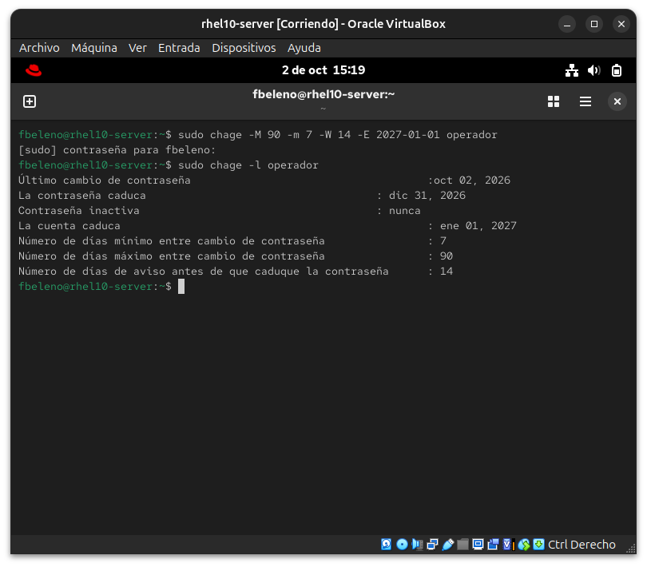
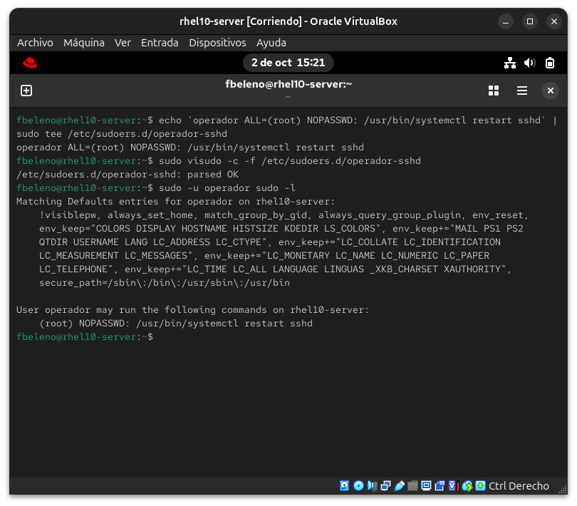
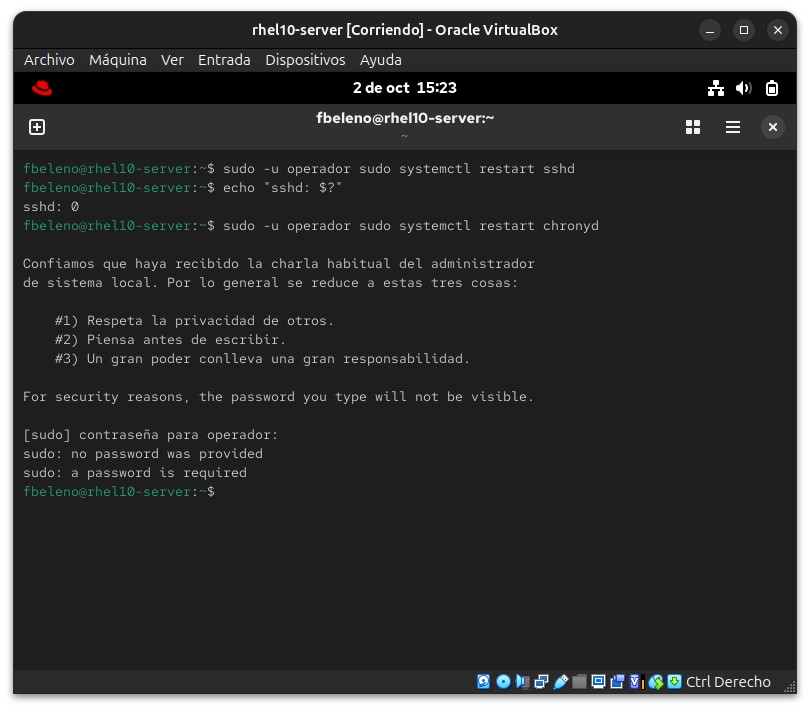

# Módulo 14 — Usuarios/grupos, `chage`, sudo granular

- Estado: Completado
- Fecha: 2026-10-02
- Versión: RHEL 10.2 (Coughlan)
- Objetivo diferencial frente a Fedora: `useradd`/`usermod`/`groupadd` ya
  se conocen de Arch/Fedora. Lo específico de RHEL para el examen es que
  se espera `visudo -f /etc/sudoers.d/nombre-de-archivo` para sudo
  granular — nunca editar `/etc/sudoers` directo ni usar un editor común
  (`visudo` valida sintaxis antes de guardar).

## Concepto diferencial

Los defaults de `useradd` (rango de UID, política de password) vienen de
`/etc/login.defs`. `chage -l usuario` muestra la política de expiración
completa; `-M` (días máximos), `-m` (mínimos entre cambios), `-W` (aviso
antes de expirar), `-E` (fecha de expiración de la **cuenta**, no de la
contraseña — distinción que se presta a confusión en el examen).

**Sudo granular con `Cmnd_Alias`**: en vez de meter a alguien en `wheel`
(sudo total), se le puede dar permiso solo para comandos específicos,
con o sin `NOPASSWD`.

## Práctica guiada

```bash
# defaults del sistema
cat /etc/login.defs | grep -E "^UID_MIN|^PASS_MAX_DAYS|^PASS_MIN_DAYS"

# usuario de prueba
sudo useradd -c "Usuario de prueba" operador
sudo chage -l operador

# política de expiración concreta
sudo chage -M 90 -m 7 -W 14 -E 2027-01-01 operador
sudo chage -l operador

# sudo granular: solo reiniciar un servicio puntual, sin password
echo 'operador ALL=(root) NOPASSWD: /usr/bin/systemctl restart sshd' | sudo tee /etc/sudoers.d/operador-sshd
sudo visudo -c -f /etc/sudoers.d/operador-sshd
sudo chmod 440 /etc/sudoers.d/operador-sshd

# verificación: operador puede reiniciar sshd pero no nada más
sudo -u operador sudo -l
sudo -u operador sudo systemctl restart sshd
sudo -u operador sudo systemctl restart chronyd
```

## Hallazgos reales

1. **`UID_MIN=1000`** — mismo valor que Fedora, confirma que el rango de
   UIDs para usuarios normales no es un diferenciador real entre ambas
   distros (ambas migraron de 500 a 1000 hace tiempo).
2. **`PASS_MAX_DAYS=99999`** por defecto — en la práctica, "nunca expira"
   (99999 días ≈ 273 años). Los usuarios nuevos no tienen política de
   expiración real hasta que se configure explícitamente con `chage`.
3. **`chage -E` (expiración de cuenta) y `-M` (expiración de contraseña)
   son mecanismos realmente independientes**, confirmado en la misma
   salida de `chage -l`: "La contraseña caduca: dic 31, 2026" (90 días
   desde el último cambio) vs "La cuenta caduca: ene 01, 2027" (fecha
   fija) — dos fechas distintas, dos políticas distintas.
4. **El sudo granular con `NOPASSWD` funciona exactamente a nivel de
   comando individual**: `operador` pudo reiniciar `sshd` sin contraseña
   (exit 0 inmediato) pero al intentar `systemctl restart chronyd`
   (fuera de la regla), `sudo` exigió contraseña — y como el usuario no
   tiene una configurada, quedó bloqueado con "a password is required".
   Confirma que no hay "fuga" de privilegios hacia otros comandos aunque
   ambos sean subcomandos del mismo `systemctl`.

## Evidencias

**01 — Defaults de login.defs y usuario creado**
`UID_MIN=1000`, `PASS_MAX_DAYS=99999`, `PASS_MIN_DAYS=0`, y `chage -l operador` mostrando la política por defecto (sin expiración) tras crear el usuario (hallazgos #1 y #2).


**02 — Política de expiración aplicada**
`chage -M 90 -m 7 -W 14 -E 2027-01-01` y `chage -l` confirmando las fechas de contraseña y cuenta como mecanismos separados (hallazgo #3).


**03 — Sudo granular configurado y validado con visudo**
Regla `NOPASSWD` para un comando puntual en `/etc/sudoers.d/operador-sshd`, `visudo -c` confirmando "parsed OK", y `sudo -l` mostrando exactamente ese único comando permitido.


**04 — Granularidad confirmada: permitido vs denegado**
`operador` reinicia `sshd` sin contraseña (exit 0), pero al intentar `chronyd` (fuera de la regla) queda bloqueado pidiendo una contraseña que no existe (hallazgo #4).


## Pendientes

Ninguno — módulo cerrado.
