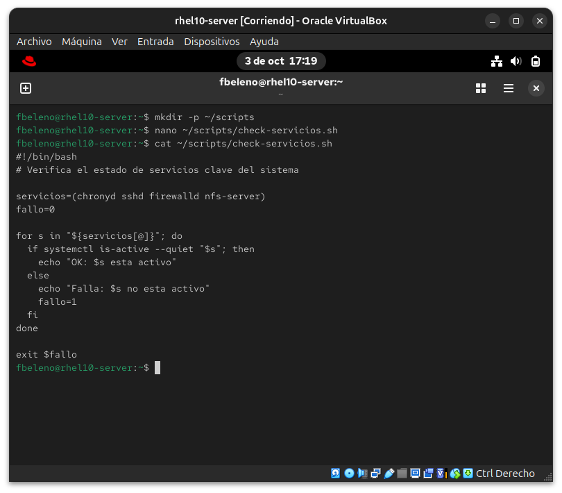
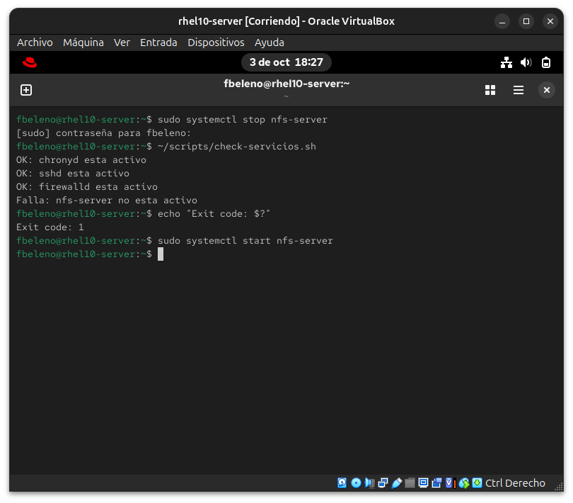

# Módulo 15 — Shell scripting a nivel de examen (cierra Fase IV)

- Estado: Completado
- Fecha: 2026-10-03
- Versión: RHEL 10.2 (Coughlan)
- Objetivo diferencial frente a Fedora: la sintaxis de bash es la misma
  en cualquier distro. Lo que el RHCSA evalúa puntualmente es
  **idempotencia** (chequear antes de actuar) y **exit codes
  correctos** — un script que "funciona" pero siempre devuelve 0 aunque
  falle adentro no sirve para una tarea evaluada.

## Concepto diferencial

El examen no pide bash avanzado, pide scripts cortos, robustos e
idempotentes (no rompen si se corren dos veces) que devuelvan el exit
code correcto (`$?`).

**Patrones clave**: parámetros posicionales (`$1`, `$@`), `[[ ]]` para
condicionales, arrays bash, `for` sobre el array, `systemctl is-active
--quiet` para chequeos silenciosos (ideal para scripts, no ensucia la
salida).

**Ejercicio del módulo**: un script que recorre una lista de servicios
(`chronyd`, `sshd`, `firewalld`, `nfs-server`) y reporta cuáles están
activos/inactivos, devolviendo un exit code distinto de 0 si alguno
falta — conecta con los módulos 10/11 (los servicios ya configurados).

## Práctica guiada

```bash
mkdir -p ~/scripts
nano ~/scripts/check-servicios.sh
```

Contenido del script:

```bash
#!/bin/bash
# Verifica el estado de servicios clave del sistema

servicios=(chronyd sshd firewalld nfs-server)
fallo=0

for s in "${servicios[@]}"; do
  if systemctl is-active --quiet "$s"; then
    echo "OK: $s esta activo"
  else
    echo "FALLA: $s no esta activo"
    fallo=1
  fi
done

exit $fallo
```

```bash
chmod +x ~/scripts/check-servicios.sh
~/scripts/check-servicios.sh
echo "Exit code: $?"

# prueba de idempotencia/exit code real: detener un servicio y volver a correr
sudo systemctl stop nfs-server
~/scripts/check-servicios.sh
echo "Exit code: $?"
sudo systemctl start nfs-server
```

## Hallazgos reales

1. **El script funcionó correctamente a la primera**, sin errores de
   sintaxis — confirma que `systemctl is-active --quiet` es confiable
   para scripting (sin salida que parsear, solo el exit code del propio
   comando determina la rama del `if`).
2. **El exit code reflejó el estado real**: con los 4 servicios activos,
   exit 0; al detener `nfs-server` a propósito, el script detectó la
   falla específica (`Falla: nfs-server no esta activo`) y devolvió
   **exit 1** — justo el comportamiento que un corrector automático de
   examen necesitaría para validar el script sin leer el texto de
   salida, solo `$?`.

## Evidencias

**01 — Script escrito y verificado**
`nano` guardando el script, confirmado completo con `cat`.


**02 — Ejecución exitosa, exit code 0**
Los 4 servicios activos, `OK` en cada uno, exit code 0.


**03 — Falla detectada, exit code 1**
`nfs-server` detenido a propósito, el script lo detecta y devuelve exit code 1 (hallazgo #2), servicio reiniciado al final.


## Pendientes

Ninguno — módulo cerrado. Cierra la Fase IV completa del curso.
