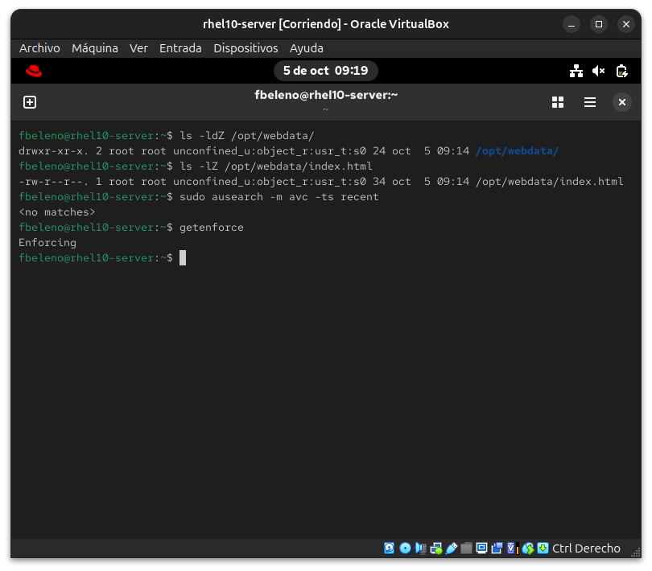
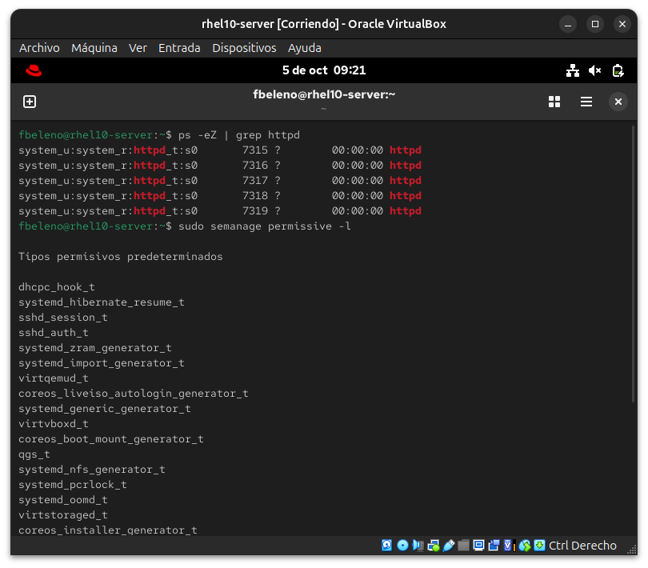
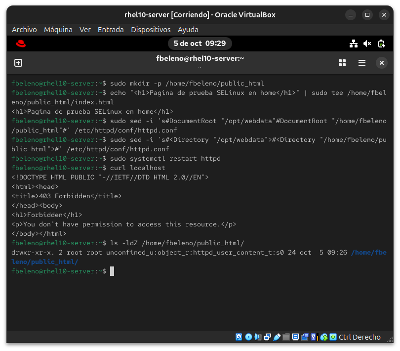
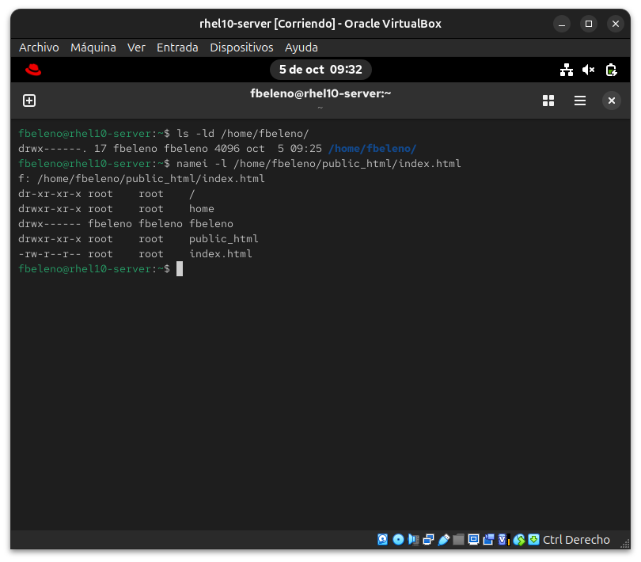
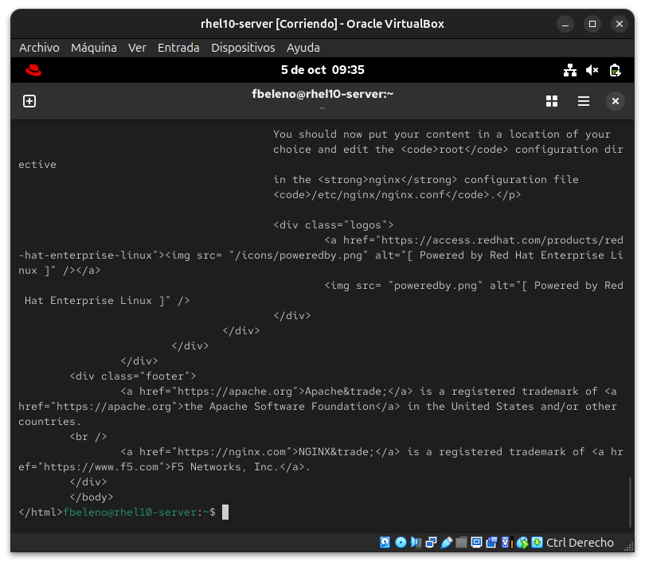
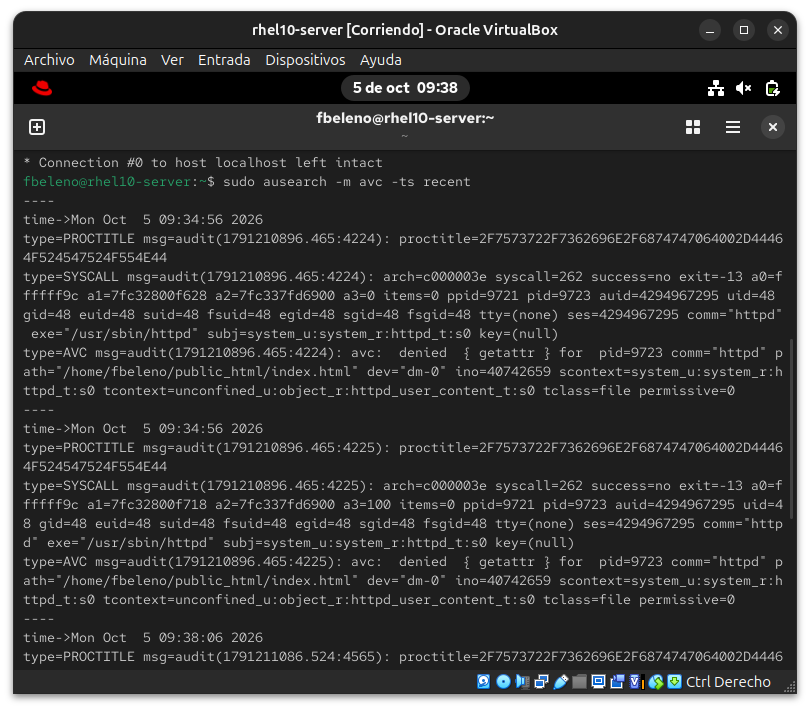
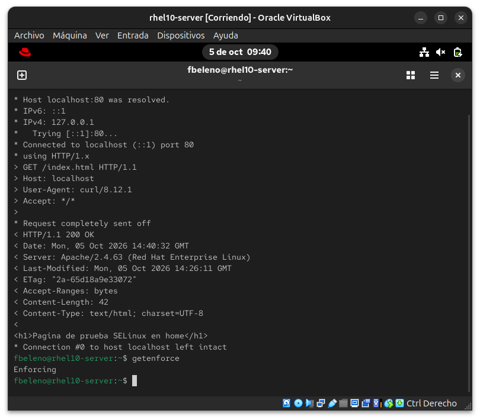
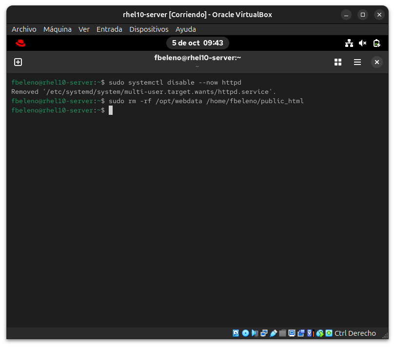

# Módulo 16 — Bucle diagnosticar → corregir → verificar (SELinux)

- Estado: Completado
- Fecha: 2026-10-05
- Versión: RHEL 10.2 (Coughlan)
- Objetivo diferencial frente a Fedora: en Fedora SELinux fue conceptual
  (modos, contextos, booleans en teoría). Acá se provoca una denegación
  real sirviendo contenido desde una ruta no estándar, y se resuelve con
  el bucle completo de diagnóstico esperado en el RHCSA.

## Concepto diferencial

Instalar `httpd` y servir contenido desde una ruta **no estándar** (ej.
`/opt/webdata` en vez de `/var/www/html`) — SELinux bloquea el acceso
aunque los permisos Unix estén perfectos, porque el contexto de archivo
no es el esperado para un proceso `httpd_t`.

**Herramientas del bucle**: `ausearch -m avc -ts recent` o `journalctl -t
setroubleshoot` para la denegación cruda; `sealert -a
/var/log/audit/audit.log` para la explicación humana con solución
sugerida; `semanage fcontext -a -t httpd_sys_content_t '/ruta(/.*)?'` +
`restorecon -Rv /ruta` para la corrección persistente (no `chcon` suelto,
que se pierde en el próximo relabel).

**La trampa clásica**: `setenforce 0` "arregla" cualquier cosa, pero es
la respuesta incorrecta en el examen — apaga la protección en vez de
resolver el contexto.

## Práctica guiada

```bash
getenforce
sudo dnf install -y httpd setroubleshoot-server
sudo systemctl enable --now httpd
sudo firewall-cmd --permanent --add-service=http
sudo firewall-cmd --reload

# intento 1: servir desde /opt (NO genera denegación, ver hallazgo #1)
sudo mkdir -p /opt/webdata
echo "<h1>Pagina de prueba SELinux</h1>" | sudo tee /opt/webdata/index.html
sudo sed -i 's#DocumentRoot "/var/www/html"#DocumentRoot "/opt/webdata"#' /etc/httpd/conf/httpd.conf
sudo sed -i 's#<Directory "/var/www/html">#<Directory "/opt/webdata">#' /etc/httpd/conf/httpd.conf
sudo systemctl restart httpd
curl localhost
ls -ldZ /opt/webdata
sudo ausearch -m avc -ts recent

# intento 2: servir desde un home de usuario (el caso real que sí bloquea)
sudo mkdir -p /home/fbeleno/public_html
echo "<h1>Pagina de prueba SELinux en home</h1>" | sudo tee /home/fbeleno/public_html/index.html
sudo sed -i 's#DocumentRoot "/opt/webdata"#DocumentRoot "/home/fbeleno/public_html"#' /etc/httpd/conf/httpd.conf
sudo sed -i 's#<Directory "/opt/webdata">#<Directory "/home/fbeleno/public_html">#' /etc/httpd/conf/httpd.conf
sudo systemctl restart httpd
curl localhost          # 403 Forbidden
ls -ldZ /home/fbeleno/public_html

# diagnóstico capa 1: permisos Unix (DAC)
ls -ld /home/fbeleno
namei -l /home/fbeleno/public_html/index.html
sudo chmod o+x /home/fbeleno

# diagnóstico capa 2: SELinux real (pedir el archivo exacto, sin pasar por welcome.conf)
curl -v localhost/index.html     # todavía 403
sudo ausearch -m avc -ts recent
getsebool httpd_enable_homedirs

# corregir con la herramienta correcta (boolean, no chcon ni setenforce 0)
sudo setsebool -P httpd_enable_homedirs on

# verificar
curl -v localhost/index.html
getenforce

# limpieza del laboratorio
sudo systemctl disable --now httpd
sudo rm -rf /opt/webdata /home/fbeleno/public_html
```

## Hallazgos reales

1. **`/opt` no sirvió para provocar la denegación**: el contexto por
   defecto de archivos bajo `/opt` es `usr_t`, y resulta que `usr_t` es
   uno de los pocos tipos **genéricamente legibles** en la política de
   referencia de SELinux (pensado para contenido estático de `/usr`,
   compartido entre dominios confinados). `httpd_t` pudo leerlo sin
   ninguna denegación, con SELinux confirmado en `Enforcing` y el
   dominio del proceso confirmado como `httpd_t` real (no permisivo). El
   caso de libro de texto que sí bloquea es servir desde un **home de
   usuario**.
2. **El contexto de `/home/fbeleno/public_html` ya venía correcto**:
   `httpd_user_content_t`, no el genérico `user_home_t` — la política de
   RHEL reconoce automáticamente el patrón de carpeta `public_html` y la
   etiqueta bien de entrada. El problema real no fue el contexto del
   archivo, sino un **boolean** (`httpd_enable_homedirs`) que controla si
   `httpd_t` puede usar ese contexto en absoluto.
3. **El primer 403 real no era de SELinux, era de permisos Unix (DAC)**:
   `/home/fbeleno` tenía `drwx------` (700) — `apache` ni siquiera podía
   atravesar el directorio para llegar al archivo. `ausearch` no mostró
   nada porque SELinux nunca llegó a evaluar nada; el proceso se detuvo
   en la capa de permisos Unix, una capa anterior e independiente de
   SELinux. Confirma que "Forbidden" puede venir de DAC, de SELinux, o
   de ambos combinados — hay que diagnosticar cada capa por separado.
4. **`/etc/httpd/conf.d/welcome.conf` enmascaró el diagnóstico**: tiene
   un `ErrorDocument 403 /.noindex.html` que intercepta cualquier 403 en
   la ruta raíz (`/`) y muestra la página de bienvenida de Red Hat en vez
   del error real. Pedir `curl localhost/index.html` (la ruta exacta, no
   `/`) esquivó ese interceptor y mostró el verdadero estado (403 directo
   con mensaje real, después el AVC denial en el log).
5. **La corrección con `setsebool -P httpd_enable_homedirs on` resolvió
   todo sin tocar `setenforce`**: `curl -v localhost/index.html` devolvió
   `200 OK` con el contenido real, y `getenforce` siguió en `Enforcing`
   durante todo el proceso — la trampa de "apagar SELinux para que
   funcione" nunca hizo falta.

## Evidencias

**01 — Contexto por defecto de /opt (hallazgo #1)**
`ls -ldZ`/`ausearch` sobre `/opt/webdata`: contexto `usr_t`, sin ninguna denegación, acceso servido sin problema pese a no ser el contexto "correcto" de httpd.


**02 — Dominio real de httpd confirmado**
`ps -eZ` mostrando `httpd_t` real para todos los procesos, y `semanage permissive -l` confirmando que `httpd_t` no está en la lista de dominios permisivos — la ausencia de denegación en `/opt` no fue por SELinux desactivado.


**03 — 403 real sirviendo desde home de usuario**
Cambio a `/home/fbeleno/public_html`, `403 Forbidden` real, y contexto `httpd_user_content_t` ya correcto de entrada (hallazgo #2).


**04 — Diagnóstico de la capa DAC (hallazgo #3)**
`ausearch` sin resultados, `getsebool httpd_enable_homedirs` en `off`, y `ls -ld`/`namei -l` revelando `/home/fbeleno` en `700` — la causa real no era SELinux todavía.


**05 — welcome.conf enmascarando el error (hallazgo #4)**
Tras corregir el DAC, `curl localhost` muestra la página de bienvenida de Red Hat en vez del error real — confirmado el interceptor en `welcome.conf`.


**06 — AVC real revelado**
`curl -v localhost/index.html` mostrando el 403 directo (sin disfraz), y `ausearch` con el AVC denial real: `httpd_t` vs `httpd_user_content_t`.


**07 — Corrección con setsebool y verificación final**
`setsebool -P httpd_enable_homedirs on`, `curl -v` devolviendo `200 OK` con el contenido real, y `getenforce` confirmando `Enforcing` durante todo el proceso (hallazgo #5).


**08 — Limpieza del laboratorio**
`httpd` deshabilitado y los directorios de prueba eliminados.


## Pendientes

Ninguno — módulo cerrado.
