# Módulo 17 — Romper y arreglar un servicio real x5

- Estado: Completado
- Fecha: 2026-10-05
- Versión: RHEL 10.2 (Coughlan)
- Objetivo diferencial frente a Fedora: no hay teoría nueva — es puro
  entrenamiento de reflejos sobre herramientas ya vistas en el módulo 16
  (`ausearch`, `semanage`, `setsebool`, `restorecon`), repetidas sobre
  distintos escenarios para automatizar el diagnóstico.

## Concepto diferencial

El módulo 16 fue el diagnóstico profundo con tiempo para investigar cada
capa. Este módulo es velocidad: 5 ciclos rápidos de romper/diagnosticar/
arreglar, variando el tipo de problema SELinux cada vez.

**Los 5 escenarios**:
1. `sshd` en puerto no estándar (`2222`) — `semanage port -a -t
   ssh_port_t -p tcp 2222`.
2. `httpd` en puerto no estándar (`8081`) — mismo patrón con
   `http_port_t`.
3. Archivo movido con `mv` pierde el contexto SELinux correcto (a
   diferencia de `cp`, que asigna contexto nuevo por defecto).
4. Boolean de red: `httpd_can_network_connect`.
5. `vsftpd` con directorio de usuario (`ftp_home_dir`).

## Práctica guiada

### Escenario 1 — sshd en puerto 2222

```bash
sudo semanage port -l | grep ssh
sudo sed -i 's/#Port 22/Port 2222/' /etc/ssh/sshd_config
sudo systemctl restart sshd
systemctl status sshd --no-pager
sudo ausearch -m avc -ts recent

sudo semanage port -a -t ssh_port_t -p tcp 2222
sudo systemctl restart sshd
systemctl status sshd --no-pager
```

### Escenario 2 — httpd en puerto 8081

```bash
sudo semanage port -l | grep http_port_t
sudo sed -i 's/Listen 80/Listen 8081/' /etc/httpd/conf/httpd.conf
sudo systemctl restart httpd
sudo ausearch -m avc -ts recent
sudo semanage port -a -t http_port_t -p tcp 8081
sudo systemctl restart httpd
curl localhost:8081
```

### Escenario 3 — mv pierde contexto

```bash
echo "contenido de prueba" | sudo tee /root/pagina.html
sudo mkdir -p /var/www/html
sudo mv /root/pagina.html /var/www/html/pagina.html
ls -lZ /var/www/html/pagina.html
curl localhost/pagina.html
sudo restorecon -v /var/www/html/pagina.html
curl localhost/pagina.html
```

### Escenario 4 — httpd_can_network_connect

```bash
getsebool httpd_can_network_connect
sudo setsebool -P httpd_can_network_connect on
getsebool httpd_can_network_connect
```

### Escenario 5 — vsftpd y el boolean de home dirs (ajustado en vivo)

```bash
sudo dnf install -y vsftpd
sudo systemctl enable --now vsftpd
getsebool ftp_home_dir              # no existe en esta política (hallazgo #5)
getsebool -a | grep -i ftp          # buscar el nombre real

# prueba real en vez de adivinar el boolean
sudo firewall-cmd --permanent --add-service=ftp
sudo firewall-cmd --reload
curl -u fbeleno: ftp://localhost/
sudo ausearch -m avc -ts recent     # sin denegación: el problema no era SELinux
```

### Limpieza final

```bash
sudo systemctl disable --now vsftpd httpd sshd
sudo sed -i 's/Port 2222/#Port 22/' /etc/ssh/sshd_config
sudo sed -i 's/Listen 8081/Listen 80/' /etc/httpd/conf/httpd.conf
sudo systemctl start sshd
sudo rm -f /var/www/html/pagina.html
```

## Hallazgos reales

1. **Un resto del módulo 16 rompió el escenario 2 antes de empezar**:
   el `DocumentRoot` de `httpd.conf` seguía apuntando a
   `/home/fbeleno/public_html` (carpeta borrada en la limpieza anterior).
   El error de arranque fue un simple error de sintaxis de configuración,
   sin relación con SELinux ni con el puerto 8081 — recordatorio de que
   siempre hay que leer el mensaje de error real (`journalctl -xeu`)
   antes de asumir que el problema es el que estabas buscando.
2. **El puerto 2222 (SSH) tenía contexto `unreserved_port_t`**, mientras
   que el puerto 8081 (HTTP) ya tenía un contexto **específico previo**:
   `transproxy_port_t` (reservado para proxies transparentes tipo
   Squid). `semanage port -a` detectó la colisión ("already defined,
   modifying instead") y lo reconvirtió a `http_port_t` sin error —
   confirma que no todos los puertos "libres" parten del mismo contexto
   genérico.
3. **`mv` preserva el contexto de origen, nunca adopta el del destino**:
   un archivo movido desde `/root` (contexto `admin_home_t`) a
   `/var/www/html` siguió teniendo `admin_home_t` — 403 real hasta
   correr `restorecon`, que lo relabeló a `httpd_sys_content_t` según la
   política del directorio de destino, no según el comando que lo movió.
4. **`httpd_can_network_connect` cambió de `off` a `on` sin fricción**,
   el boolean más simple de los cinco escenarios — útil como caso base
   de comparación contra los demás, más complejos.
5. **`ftp_home_dir` no existe en la política de RHEL 10** — al intentar
   `setsebool`, el sistema respondió "Boolean ftp_home_dir is not
   defined". `getsebool -a | grep ftp` reveló los booleans reales
   disponibles (`ftpd_*`, `httpd_can_connect_ftp`,
   `httpd_enable_ftp_server`, `tftp_home_dir` — este último para TFTP,
   un protocolo distinto). Lección real: no hay que memorizar nombres de
   booleans de documentación vieja/genérica — hay que confirmarlos en el
   sistema real con `getsebool -a | grep <servicio>` antes de usarlos.
6. **El fallo final de `vsftpd` (530, acceso denegado) no tuvo ninguna
   denegación de SELinux** (`ausearch` sin resultados, config de PAM
   correcta) — confirma que no todo error de un servicio es SELinux, y
   que el primer paso de cualquier diagnóstico real es descartarlo o
   confirmarlo con `ausearch`, no asumirlo.

## Evidencias

**01 — Escenario 1: sshd en puerto 2222, denegación y corrección**
AVC real con `unreserved_port_t`, y la verificación final con `sshd` corriendo y escuchando en el puerto 2222 tras `semanage port -a`.
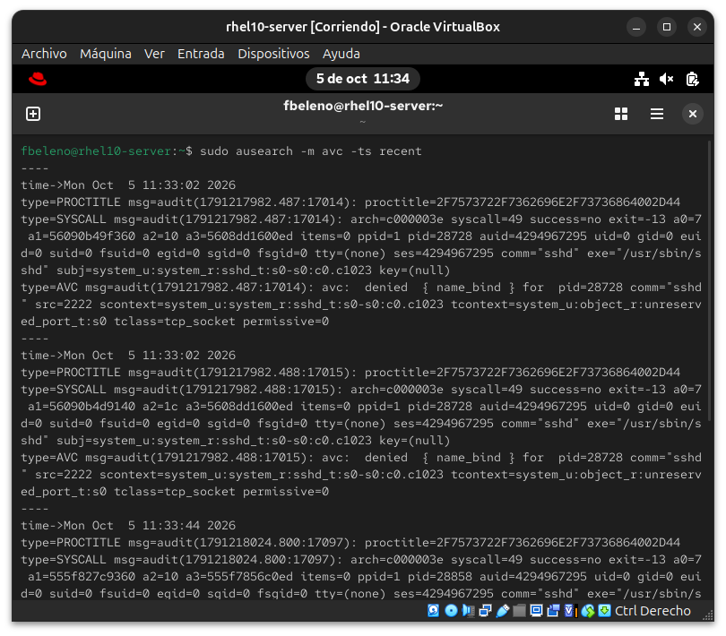
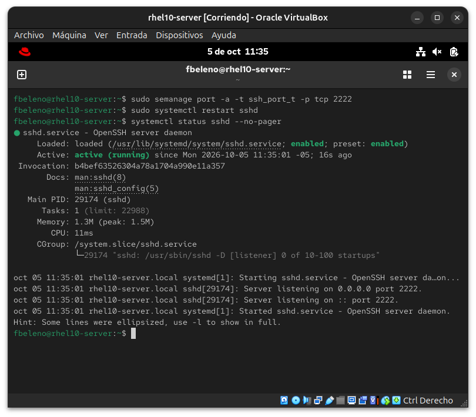

**02 — Hallazgo: resto del módulo 16 bloqueando el escenario 2**
Error de sintaxis por el `DocumentRoot` apuntando a una carpeta ya borrada (hallazgo #1), antes de llegar al problema real de SELinux.
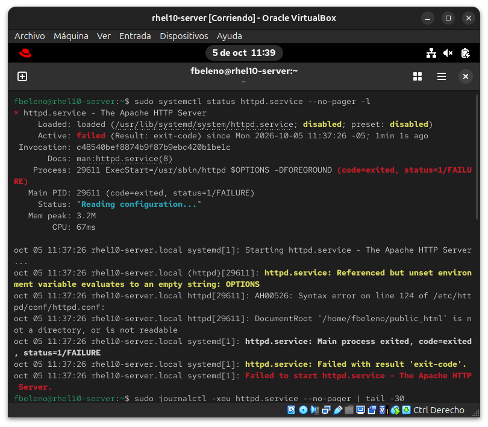

**03 — Escenario 2: httpd en puerto 8081, contexto previo distinto**
AVC con `transproxy_port_t` (contexto previo del puerto 8081, hallazgo #2), `semanage port -a` reconvirtiendo a `http_port_t`, y `curl` exitoso final en el puerto 8081.
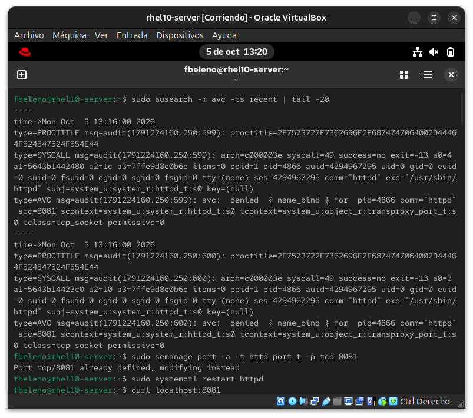
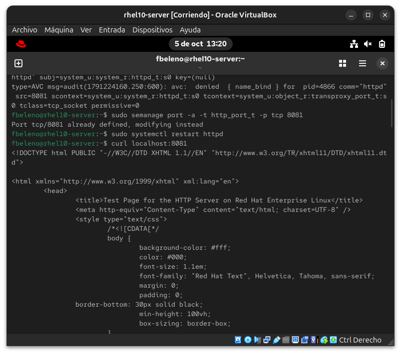

**04 — Escenario 3: mv preserva el contexto de origen**
`ls -lZ` confirmando `admin_home_t` tras el `mv` y 403 real (hallazgo #3), y `restorecon` relabelando a `httpd_sys_content_t` con `curl` exitoso después.
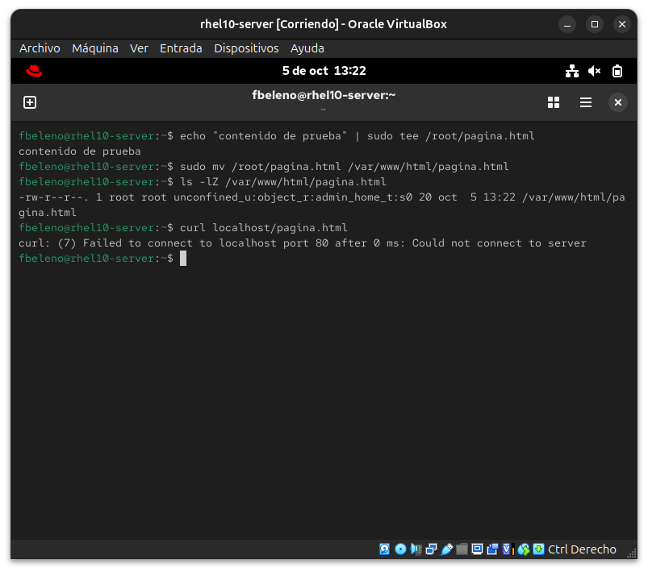
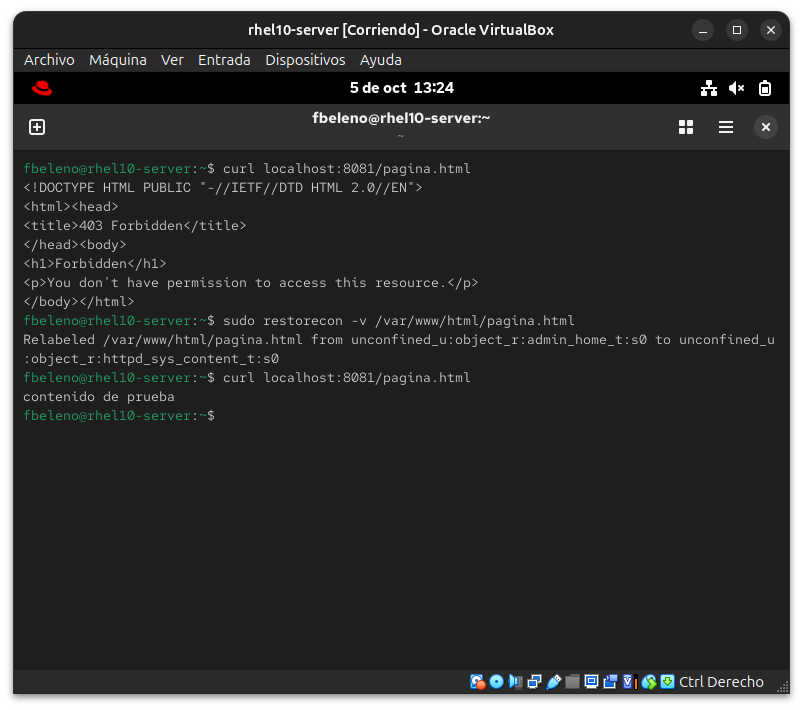

**05 — Escenario 4: httpd_can_network_connect**
`getsebool`/`setsebool -P` de off a on, el escenario más directo de los cinco.
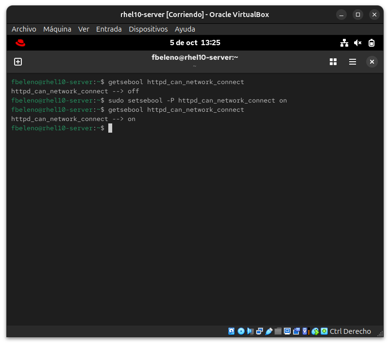

**06 — Escenario 5: vsftpd instalado, boolean inexistente**
Instalación de `vsftpd`, y el error real al intentar `ftp_home_dir` (hallazgo #5).
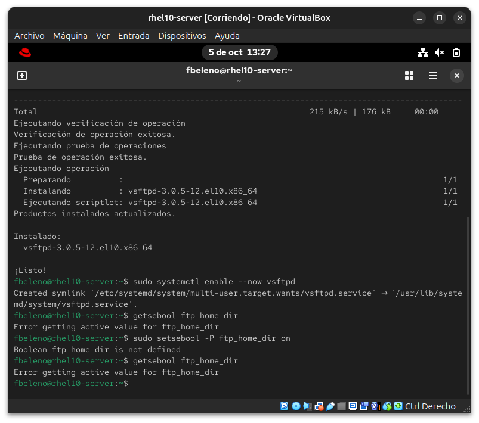

**07 — Búsqueda de booleans reales de FTP**
`getsebool -a | grep ftp` mostrando el catálogo real de booleans relacionados, sin ningún `ftp_home_dir` clásico.
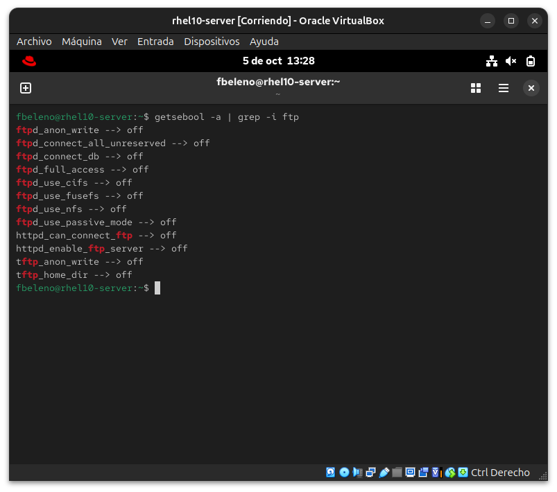

**08 — Fallo de vsftpd por typo propio, corregido**
`ftps=NO` como directiva inválida (error mío, no del alumno), corregido eliminando la línea, servicio arrancando limpio.
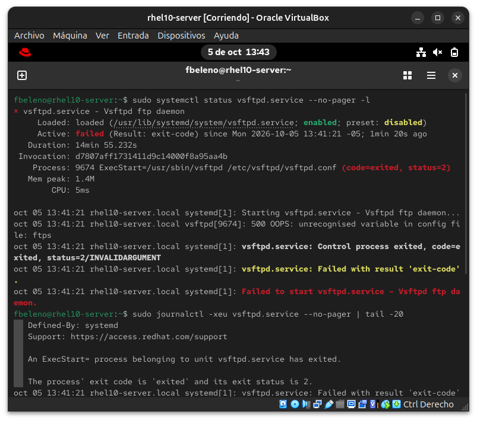

**09 — Diagnóstico final: 530 sin relación con SELinux**
`journalctl`/`status` del arranque exitoso de `vsftpd`, el `530` de curl, y confirmación de PAM/config correctos.
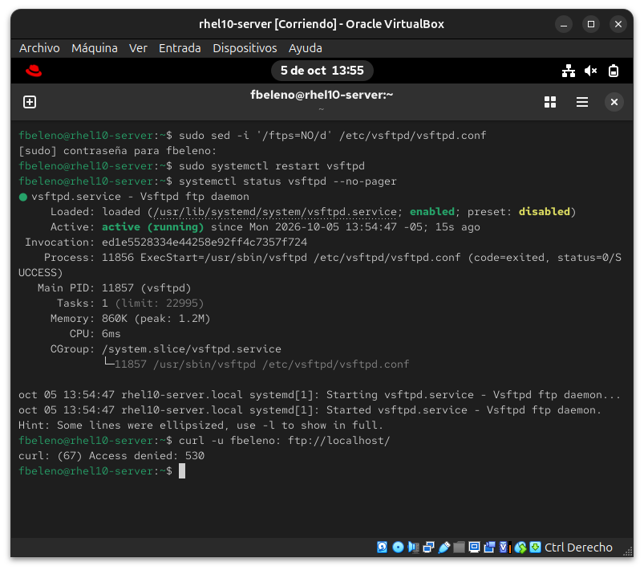

**10 — Ausencia de AVC confirmada (hallazgo #6)**
`ausearch` sin resultados y config de `local_enable`/`pam_service_name` correcta — el 530 no es un problema de SELinux.
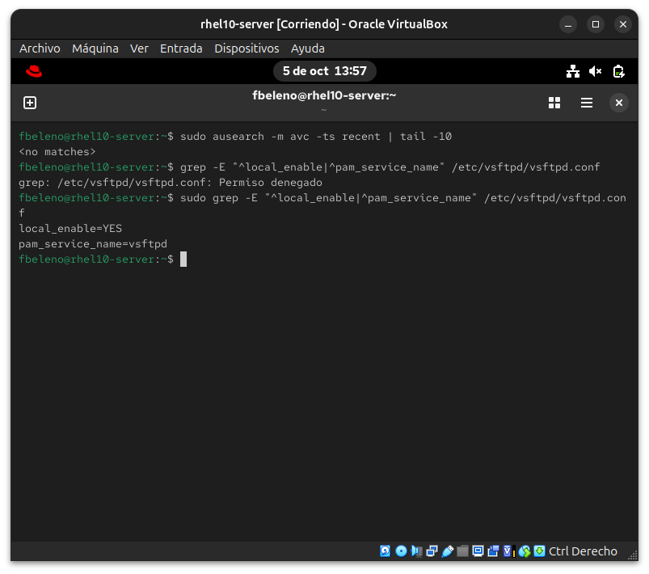

**11 — Limpieza final de los 5 escenarios**
Los tres servicios deshabilitados, puertos revertidos a su configuración original, archivos de prueba eliminados.
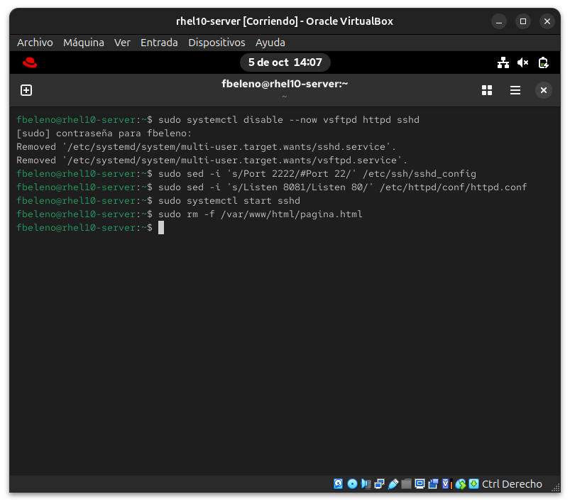

## Pendientes

Ninguno — módulo cerrado.
