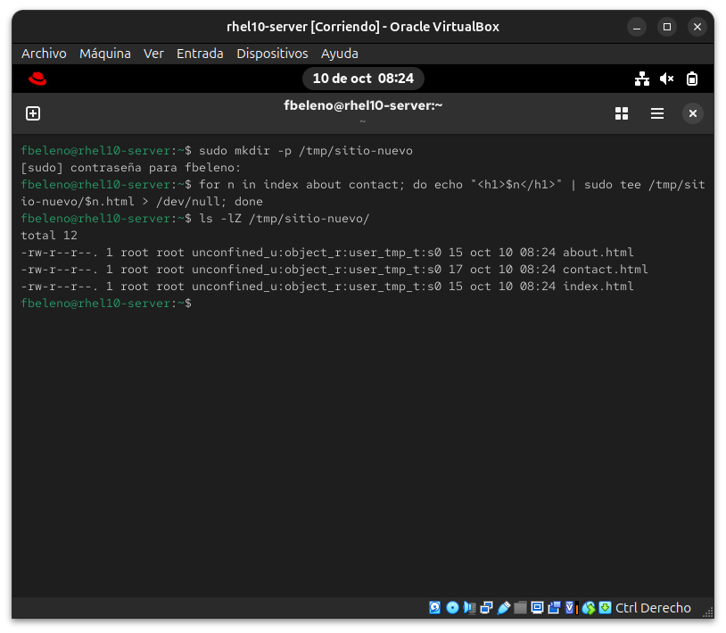
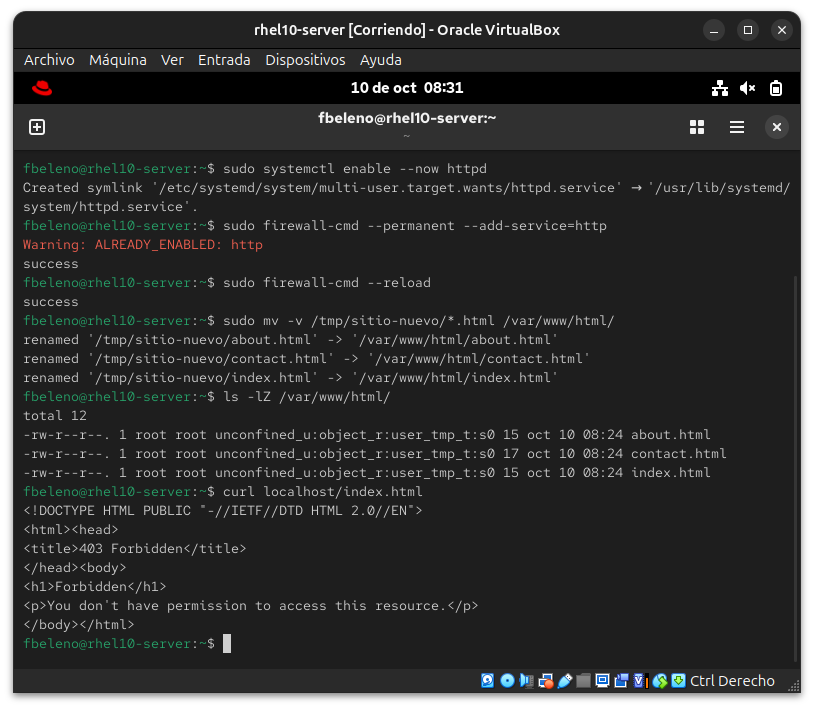
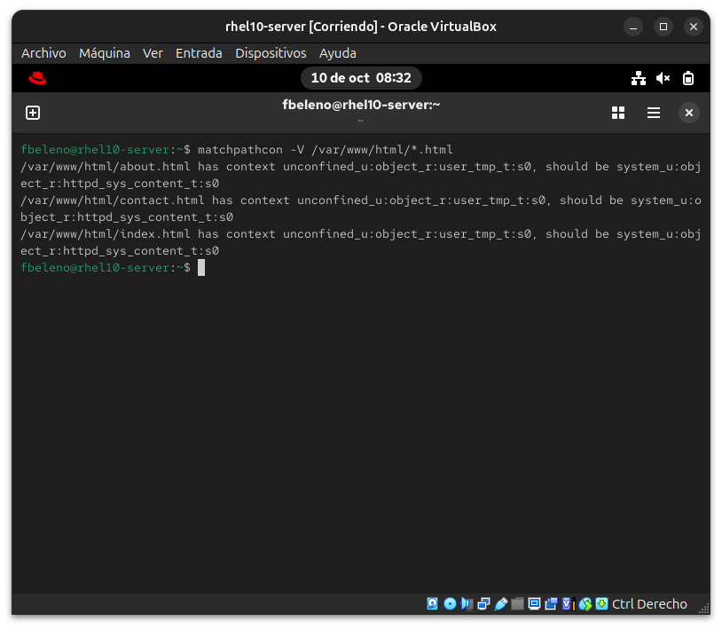
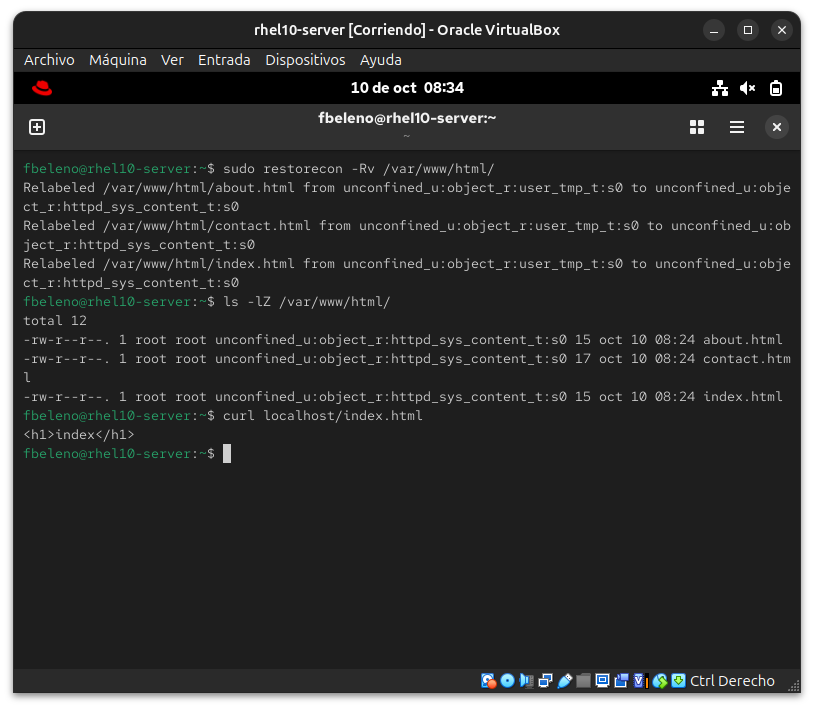

# Módulo 18 — Contexto roto tras mover archivos 🔧 Break & Fix (cierra Fase V)

- Estado: Completado
- Fecha: 2026-10-10
- Versión: RHEL 10.2 (Coughlan)
- Objetivo diferencial frente a Fedora: mismo mecanismo que en el módulo
  17 (`mv` preserva el contexto de origen) pero a escala real — un árbol
  completo de archivos, con diagnóstico que debe medir qué tan extendido
  está el problema antes de corregir, no solo arreglar un archivo suelto.

## Concepto diferencial

Simular una migración real: contenido web armado en una ubicación
temporal (`/tmp/sitio-nuevo/`), movido con `mv -v` recursivo a
`/var/www/html` — la operación típica de un sysadmin apurado sin pensar
en SELinux.

**Herramienta nueva**: `matchpathcon -V /ruta/*` verifica en lote si los
archivos coinciden con el contexto que la política espera, diagnóstico
proactivo antes de que algo falle.

## Cambio deliberado

```bash
sudo mkdir -p /tmp/sitio-nuevo
for n in index about contact; do echo "<h1>$n</h1>" | sudo tee /tmp/sitio-nuevo/$n.html > /dev/null; done
ls -lZ /tmp/sitio-nuevo/

sudo dnf install -y httpd
sudo systemctl enable --now httpd
sudo firewall-cmd --permanent --add-service=http
sudo firewall-cmd --reload

sudo mv -v /tmp/sitio-nuevo/*.html /var/www/html/
ls -lZ /var/www/html/
curl localhost/index.html
```

## Síntoma

Los 3 archivos movidos conservan el contexto de origen (`user_tmp_t`,
propio de `/tmp`), visible con `ls -lZ` inmediatamente después del `mv`.
`curl localhost/index.html` devuelve **403 Forbidden** — y es el mismo
resultado para los 3 archivos, no uno aislado: toda la "migración"
quedó rota de una sola vez.

## Diagnóstico y recuperación

**Observación**: el `mv` recursivo (`mv -v /tmp/sitio-nuevo/*.html
/var/www/html/`) confirmó el renombrado de los 3 archivos sin error — a
nivel de archivo todo salió bien, el problema es invisible hasta que se
intenta acceder vía `httpd`.

**Diagnóstico proactivo con `matchpathcon -V`**: en vez de ir archivo por
archivo adivinando o esperando a que cada uno falle, `matchpathcon -V
/var/www/html/*.html` comparó los 3 contra la política de una sola vez:
los 3 reportaron `user_tmp_t`, debiendo ser `httpd_sys_content_t`. Esto
confirma el alcance completo del problema antes de tocar nada — útil
cuando la "migración" real mueve docenas o cientos de archivos, no 3.

**Solución aplicada**: `restorecon -Rv /var/www/html/` relabeló los 3
archivos en una sola pasada recursiva, sin necesidad de corregir uno por
uno con `chcon` ni de repetir `semanage fcontext` (el contexto esperado
para `/var/www/html` ya estaba definido en la política por defecto, solo
hacía falta aplicarlo).

**Validación**: `ls -lZ` confirma `httpd_sys_content_t` en los 3
archivos, y `curl localhost/index.html` devuelve el contenido real
(`<h1>index</h1>`) en vez del 403.

## Impacto y riesgos

En una migración real con cientos o miles de archivos, este mismo error
multiplicado significa que **todo el sitio queda caído tras el
despliegue**, no solo un archivo — y el síntoma (`403 Forbidden`
genérico) no distingue entre "permisos Unix mal puestos", "SELinux
bloqueando" o "archivo realmente ausente", lo que puede hacer perder
tiempo valioso revisando la capa equivocada primero si no se tiene el
hábito de chequear el contexto SELinux como sospechoso temprano,
especialmente después de cualquier operación de `mv` entre jerarquías de
directorios con distinto propósito (`/tmp`, home de usuario, `/opt`,
etc.) hacia una ruta servida por un proceso confinado.

## Cómo evitar recurrencia

- **Preferir `cp -a` + verificación, o `rsync`, sobre `mv`** cuando el
  origen y destino tienen propósitos SELinux distintos — `cp` sin `-a`
  adopta el contexto del directorio destino por defecto (el
  comportamiento que sí queremos); `mv` nunca lo hace.
- Si `mv` es inevitable (por ejemplo, para no duplicar espacio en disco
  temporalmente), **correr `restorecon -Rv` como parte del mismo
  procedimiento de despliegue**, no como un paso de diagnóstico posterior
  cuando algo ya falló.
- Usar `matchpathcon -V` como chequeo de salud **antes** de un corte de
  servicio o un despliegue en producción, no solo después de que un
  usuario reporte el problema.
- En scripts de automatización (Ansible, fase VIII), el módulo
  `ansible.posix.sefcontext` + `restorecon` después de cualquier tarea
  de `copy`/`synchronize` con `remote_src: true` desde una ruta con
  contexto distinto al destino.

## Evidencias

**01 — Archivos de origen en /tmp**
Los 3 archivos de la "migración" con contexto `user_tmp_t`, el esperado para `/tmp`.


**02 — Migración con mv y síntoma confirmado**
`dnf install` con error de DNS pero httpd ya presente de módulos anteriores, `mv -v` recursivo exitoso a nivel de archivo, `ls -lZ` mostrando `user_tmp_t` preservado en los 3, y `curl` con 403 Forbidden.


**03 — Diagnóstico proactivo con matchpathcon**
`matchpathcon -V` comparando los 3 archivos contra la política de una sola vez, confirmando el alcance completo del problema antes de corregir.


**04 — Corrección y validación final**
`restorecon -Rv` relabelando los 3 archivos en una sola pasada, `ls -lZ` confirmando `httpd_sys_content_t`, y `curl` devolviendo el contenido real.


## Pendientes

Ninguno — módulo cerrado. Cierra la Fase V completa del curso.
